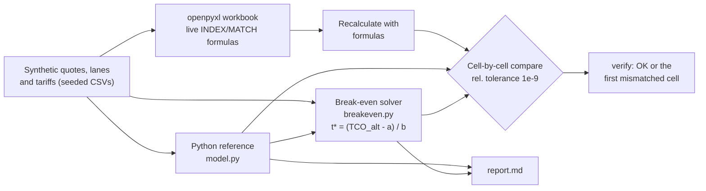

# landedcost

[](https://github.com/SlateGitOrg/landedcost/actions/workflows/ci.yml)


landedcost prices a sourcing decision the way the warehouse experiences it: unit price, freight and duty, plus the pipeline stock and safety stock that a long, variable ocean lead time forces the business to carry. It writes an Excel workbook in which every derived number is a live formula, recalculates that workbook outside Excel and checks it cell by cell against a pure-Python reference, and solves in closed form the China tariff rate at which each alternative origin starts to pay off, for every SKU. The data is synthetic.

## The problem

A hand-tools and hardware wholesale distributor sources 40 private-label SKUs from China and is deciding, SKU by SKU, whether to move them to Vietnam or Mexico as tariffs change. Buyers compare unit price plus freight and duty. That leaves out the inventory a long lead time forces the business to carry: stock owned from the moment it leaves the factory (pipeline stock), and safety stock sized for both demand variability and lead-time variability. A cheap but slow origin can lose once that is counted. Nobody knows at what tariff rate each move pays off.

## How it works



For each SKU and origin the model computes, per unit:

- landed cost = FOB x FX + freight + duty + port and drayage, where duty = customs value x (base duty + additional tariff) and freight = container cost / usable cube x unit cube;
- pipeline carrying = transit days / 365 x landed x carrying rate;
- safety-stock carrying = z x sqrt(L x sd_d^2 + d^2 x sd_L^2) x landed x carrying rate / annual demand, with d = annual demand / 52 and L, sd_L the lead time mean and SD in weeks;
- cycle-stock carrying = order quantity / 2 x landed x carrying rate / annual demand.

Total cost is the sum. Carrying cost is charged on the full landed cost (including freight, duty and port), not on FOB alone, and lead time is the origin's ocean or truck transit time only: there is no factory production or order-processing time. Every carrying charge is proportional to landed cost, and landed cost is linear in the incumbent's additional tariff t, so total cost is `a + b t` and an alternative with total cost `TCO_alt` ties at `t* = (TCO_alt - a) / b`. The workbook sheets are `Inputs_SKU`, `Inputs_Origin`, `Quotes`, `Tariffs`, `FX`, `Params` (defined names `Carrying_Rate`, `Service_Level`), `Calc` (one row per SKU x origin), `Compare` (best origin, saving, break-even tariff), `Scenario` (China tariff 0-60% in 5-point steps, plus a what-if cell) and `Notes`.

## Quick start

Python 3.11+.

```bash
python -m venv .venv && source .venv/bin/activate
pip install -e ".[dev]"

landedcost generate --seed 7 --out data          # seeded inputs (already committed in data/)
landedcost compute --data data --top 10          # ten largest savings
landedcost breakeven --data data                 # break-even tariff, every SKU x alternative
landedcost build-workbook --data data --out out/landedcost.xlsx
landedcost verify out/landedcost.xlsx            # recalculate and compare with the reference
landedcost report --data data --out out/report.md
pytest -q
```

`verify` exits non-zero and names the first mismatched cell. It also fails if a Calc or Compare cell has been overwritten with a value, since a correct hard-coded number would otherwise pass.

## Example output

All figures below come from `landedcost generate --seed 7` and the commands above.

`landedcost verify out/landedcost.xlsx`:

```
OK: 120 Calc rows and 40 Compare rows match the reference within 1e-9 (7322 cells, 14 scenario columns)
```

`landedcost compute --data data --top 10`, the ten largest annual savings against the incumbent (China, 25% additional tariff). "ahead at 0%" means the alternative is cheaper even with no China tariff; the planted tool chests are those.

| SKU | Current | Recommended | Saving / unit | Saving / year | Break-even Vietnam | Break-even Mexico |
|---|---|---|---|---|---|---|
| TS-1010 | China | Mexico | $16.1081 | $57,184 | 34.2% | ahead at 0% |
| TS-1004 | China | Mexico | $19.1152 | $52,376 | 40.3% | ahead at 0% |
| TS-1003 | China | Mexico | $20.8492 | $48,787 | 40.2% | ahead at 0% |
| TS-1002 | China | Mexico | $15.6140 | $43,095 | 36.0% | ahead at 0% |
| FK-1001 | China | Vietnam | $0.7134 | $35,449 | 18.4% | 20.1% |
| TS-1011 | China | Mexico | $2.9360 | $25,103 | 22.6% | 15.1% |
| TS-1005 | China | Mexico | $12.4988 | $19,498 | 32.2% | ahead at 0% |
| HT-1010 | China | Mexico | $1.3018 | $18,928 | 23.5% | 19.6% |
| FK-1004 | China | Mexico | $0.7597 | $18,924 | 22.1% | 15.9% |
| TS-1008 | China | Mexico | $12.7623 | $18,888 | 31.7% | ahead at 0% |

Across all 40 SKUs, 35 are cheaper outside China at the base tariff (23 to Mexico, 12 to Vietnam), worth $533,977 a year; 5 stay in China. The Vietnam break-even tariff has a median of 23.0% (range 17.9% to 40.3%); Mexico's has a median of 21.9% among the 34 SKUs where it falls inside 0-100%, and Mexico is ahead even at a 0% tariff for 6.

Scenario grid summary (SKUs won by each origin as the China additional tariff changes; each row sums to 40):

| China tariff | China | Vietnam | Mexico |
|---|---|---|---|
| 0% | 34 | 0 | 6 |
| 5% | 33 | 0 | 7 |
| 10% | 33 | 0 | 7 |
| 15% | 31 | 0 | 9 |
| 20% | 16 | 4 | 20 |
| 25% | 5 | 12 | 23 |
| 30% | 0 | 16 | 24 |
| 35% to 60% | 0 | 16 | 24 |

Flip list: SKUs where price + freight + duty + port picks Vietnam, but the lowest total cost, with pipeline and safety stock counted, is China.

| SKU | Description | Cheapest on landed cost | Landed gap | Total-cost gap |
|---|---|---|---|---|
| HT-1004 | Stud finder with deep scan | Vietnam | -0.57% | +0.18% |
| HT-1006 | Digital torque wrench 1/2 in | Vietnam | -0.58% | +0.17% |
| HT-1013 | Digital caliper 6 in | Vietnam | -0.39% | +0.36% |
| HT-1015 | Cordless rotary multi-tool kit | Vietnam | -0.67% | +0.07% |
| HT-1019 | Laser distance measurer 100 ft | Vietnam | -0.49% | +0.25% |

The gaps are small because the pattern is a margin effect: Vietnam is 0.4% to 0.7% cheaper before inventory and 0.07% to 0.36% dearer after it. These five break even on the China tariff between 25% and 26%, so a small tariff cut keeps China ahead.

## Design decisions

1. **Closed-form break-even instead of a root search.** Because every carrying charge scales with landed cost, total cost is exactly linear in the incumbent's tariff, so `t* = (TCO_alt - a) / b` needs no iteration and appears in the workbook as ordinary cell formulas. The cost is that the result depends on that proportionality: if order quantity or the carrying rate varied with the tariff, the line would bend. Tests check the solution by substitution (set the China tariff to `t*`, recompute everything, totals agree to 1e-9).
2. **Safety stock from a cycle service level.** `z x sqrt(L sd_d^2 + d^2 sd_L^2)` with `z = NORM.S.INV(97%)` is a standard, auditable formula that includes lead-time variance, which is what penalises the slow, variable origin. It ignores how large a stockout is (a fill-rate target would not) and assumes normal, independent demand and lead time. The Notes sheet states this.
3. **Recalculation with `formulas`, not Excel or LibreOffice.** It runs anywhere Python does, offline, in CI. The price is that it is not Excel's engine: the workbook sticks to functions it supports (INDEX, MATCH, SQRT, SUMPRODUCT, `_xlfn.NORM.S.INV`). `verify` also asserts that cells are still formulas, because replacing a formula with its correct value would otherwise be invisible.
4. **One quote sheet with a `SKU|origin` key.** Quotes are a long table keyed by a text column and read with INDEX/MATCH, which works in every Excel version and avoids array formulas. The key column has to stay consistent with the SKU and origin columns beside it.
5. **Same order quantity and carrying rate for every origin.** Mexico by truck could realistically ship smaller lots, which would lower its cycle stock. Holding these equal keeps the comparison about lead time, freight and tariffs, and is conservative for Mexico.
6. **Planted patterns by constrained redraw.** The generator draws each planted SKU from ranges that make its pattern likely and redraws until it holds, so the tool-chest, flip and non-qualifying sets are exact for any seed. The flip SKUs are therefore not independent draws, and their margins are thin by construction. Plain SKUs are rejection-sampled too: a draw is kept only if it is not a flip, so the flip list is exactly the planted set.

## Testing

```bash
pytest -q
```

65 tests, offline, with warnings treated as errors. They cover the fixture SKU (landed $15.0500, safety stock 526.09 units, pipeline $0.3447, safety-stock $0.1452, cycle-stock $0.2759, total $15.8158), the safety-stock variance terms, break-even by substitution, blank break-evens outside 0-100%, recovery of the planted patterns from the data (6 chests choose Mexico at a 0% China tariff, the flip set equals the 5 planted SKUs, none of the 4 non-qualifying SKUs choose Mexico), scenario columns summing to 40 with China's wins non-increasing, workbook hygiene (no numeric literals in Calc and Compare formulas other than 0, 1, 2, 7, 52, 100, 365), and `verify` passing, and failing with the cell named when a formula is replaced by a value or changed. The workbook tests recalculate with `formulas`, so the suite takes about a minute.

## Project layout

```
src/landedcost/
  data.py        input records, CSV and params persistence
  generate.py    seeded generator and the planted patterns
  model.py       pure-function reference: landed cost, carrying charges, comparison
  breakeven.py   closed-form break-even tariff
  scenario.py    wins per origin across China tariff steps
  layout.py      sheet and column layout shared by builder and verifier
  workbook.py    openpyxl workbook with live formulas; reads inputs back
  verify.py      recalculation with formulas and cell-by-cell comparison
  report.py      Markdown report
  cli.py         typer commands
data/            committed sample inputs (seed 7) and truth.json
tests/           pytest suite
.github/workflows/ci.yml
```

## License

MIT. See `LICENSE`.
